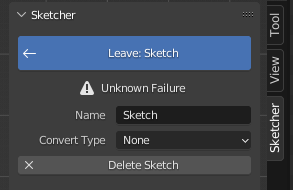

The extension utilizes the solver from [solvespace](https://solvespace.com/index.pl) which
takes a set of entities with an initial position and a set of constraints which
describe geometric relationships between entities. When the solver runs it will try
to adjust entity locations to satisfy the constraints.

## Failure
{align=right}

It's common that the solver fails to find a solution to satisfy all constraints. There
are multiple reasons why the solver might fail. Whenever this happens the active sketch
will be marked in the sidebar. It will have one of the following states:

- Okay
- Inconsistent: some constraints contradict each other. Check through the failed
  constraints and remove the ones that clash.
- Didnt Converge: the solver couldn't find a solution within its limits.
- Too Many Unknowns: the sketch has more unknowns than the solver can handle.
- Redundant Constraints: the sketch still solves, but some constraints repeat what
  others already say. It can turn into an error once the constraints stop agreeing,
  so keep only what's needed.
- Unknown Failure

Only Okay and Redundant Constraints update the geometry. With any of the others the
sketch stays as it was until the problem is fixed.

<!-- ## Best Practices

## Workflow

## Tips & Tricks -->
